# 一、 插入排序

## 1.1. 插入排序效率与比较次数

> **注意点**：注意待排序序列的有序情况。
> 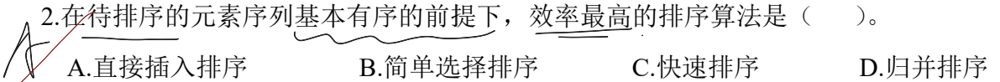
> 有序序列的排序中，直接插入排序只需和前一个元素比较，时间复杂度 O(n)，其余排序算法均大于 O(n)。

> **注意点**：最好和最坏的情况根据不同的排序算法有对应的序列。
> 
> 直接插排中，最坏时序列逆序，比较次数为 $1, 2, 3, \cdots, n = \frac{(1+n)n}{2}$
> 最好时，序列初始有序，比较次数为 $1, 1, 1, \cdot s, 1，共计n-1次$。

> **注意点**：直接插排初始越有序，比较次数越少。
> 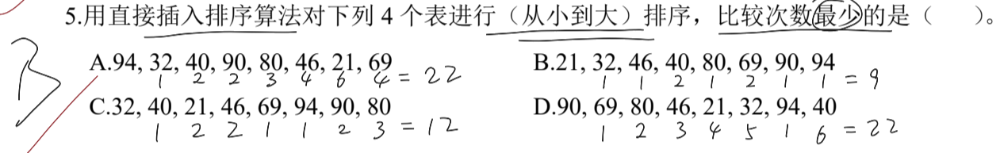
> 比较情况如上图所示。

> **注意点**：折半插入排序只是对直接插入排序的 **比较次数的优化**，但是移动次数并没有变化，因此平均时间复杂度仍然是 O(n^2) 级别。
> 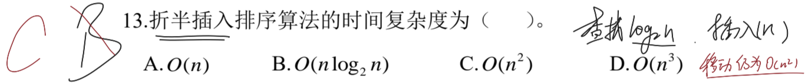

> **注意点**：和上题一致，折半插入排序只是对直接插入排序的比较次数进行优化，其余无论是移动次数、辅助空间还是排序的总趟数**均未发生变化**。
> 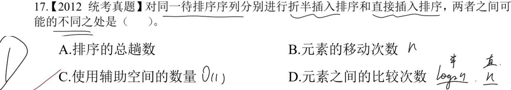

---

## 1.2. 趟数与序列对应关系

> **注意点**：直接插入排序每一趟结束后，已排序序列必定有序。
> 
> 此时如果是两趟排序的结果，可以先观察序列的前三个元素是否有序。
> **其余错误**：
> 如果是简单选择排序，每次会选择序列中最小的元素排序完成，那么两趟之后首两个元素必定是 `2, 3`；
> 如果是冒泡排序，每次会排序出最大的元素，那么两趟之后末尾两个元素必定是 `10，13`；
> 如果是堆排序，这里无论是大根堆还是小根堆均不满足性质，因此绝不可能是堆排序。

> **注意点**：希尔排序的内排序是直接插入排序，在增量 d 的作用下，取出对应元素应用直接插排后再放回，然后 d 不变，从第二个元素开始，直至所有元素均被取出过。
> 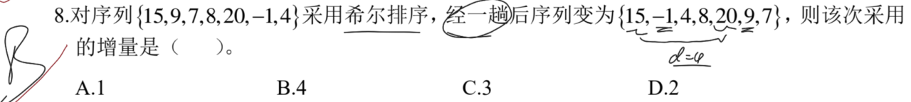
> 可以发现，初始和第一趟结束后，只有元素 `9和-1` 发生了交换，因此增量为 `4`。

> 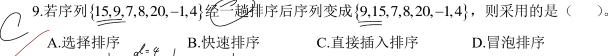
> 很显然，一趟排序之后，只有首部两个元素进行了互换，符合直接插入排序的特点。

> **注意点**：希尔排序的增量 d 指的是两个待排序元素之间的间隔为 d。
> 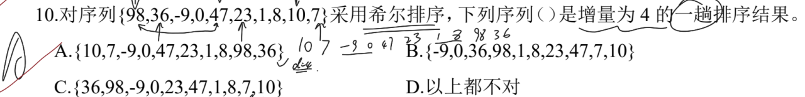
> 增量为 d 时，第一趟排序中，有如下比较：
> 第 1 次对 `98 47 10` 进行直接插排，结果为 `10 47 98`，此时序列为 `[10] 36 -9 0 [47] 23 1 8 [98] 7`；
> 第 2 次对 `36 23 7` 进行直接插排，结果为 `7 23 36`，此时序列为 `10 [7] -9 0 47 [23] 1 8 98 [36]`；
> 第 3 次对 `-9 1` 进行直接插排，结果不变；
> 第 4 次对 `0 8` 进行直接插排，结果不变。至此结束第一趟，最终第一趟排序结果为 `10 7 -9 0 47 23 1 8 98 36`。

> **注意点**：希尔排序的每一趟排序，需要将序列中的全部元素**均取出过一次**，最终的排序序列作为一趟的结果。
> 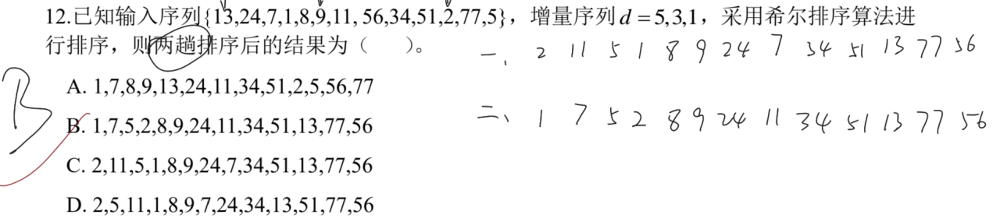
> 排序结果如上图所示：
> 第一趟结果为：`2 11 5 1 8 9 24 7 34 51 13 77 56`；
> 第二趟结果为：`1 7 5 2 8 9 24 11 34 51 13 77 56`。

> 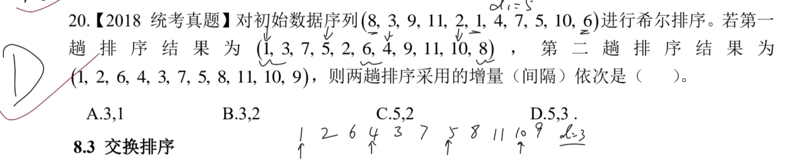
> 将选项的增量尝试带入，再比对该增量下选取的元素进行直接插排是否能得到第一趟排序后序列的同增量的排序。
> 这里推理过程如上图所示，比对即可。

---

## 1.3. 希尔排序专项

> **注意点**：希尔排序虽说具有增量、选取固定规则的元素进行排序，但其本质仍然是插入排序，被选中的元素应用的还是直接插入排序。
> 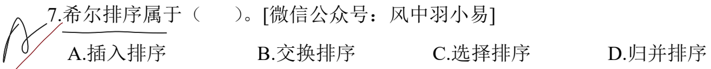

> **注意点**：希尔排序后的结果，必定是在一个增量范围下是有序序列。因此只需找到最小的有序序列对应的增量即可。
> 
> 一般来说带入选项即可，看组内是否有序，如果有序，那么这个增量便是合理的。

> 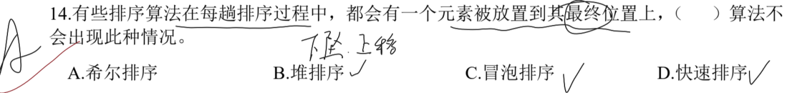
> 希尔排序虽然本质是插入排序，组内运用直接插入排序处理。
> 但是组间在同增量的情况下，并不会跨组排序，因此每一趟排序不一定会有一个元素放到最终位置。

> **注意点**：希尔排序后的结果，必定是在一个增量范围下是有序序列。因此只需找到最小的有序序列对应的增量即可。
> 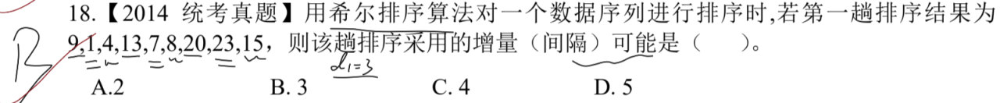
> 这里序列 `9 13 20` 和 `1 7 23` 以及 `4 8 15` 是有序的，其增量为 3。
> 如果增量为 2，此时 `9 4` 并非有序，因此不可能。

> **注意点**：组内排序采用直接插入排序。
> 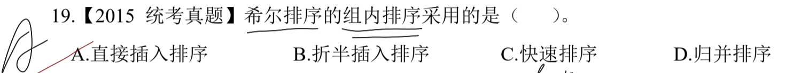

> 
> 将选项的增量尝试带入，再比对该增量下选取的元素进行直接插排是否能得到第一趟排序后序列的同增量的排序。
> 这里推理过程如上图所示，比对即可。

---

# 二、 交换排序

## 2.1. 趟数与序列对应关系

> **注意点**：冒泡排序是两两元素之间进行比较，此题需要降序序列，因此小元素将沉至最后一位。
> 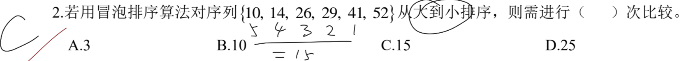
> 比较次数如上图中所示，序列本身是一个逆序序列，因此其比较次数为 15。

> **注意点**：比较各个排序方法的特点，尝试自行排序，对比结果是否匹配。
> 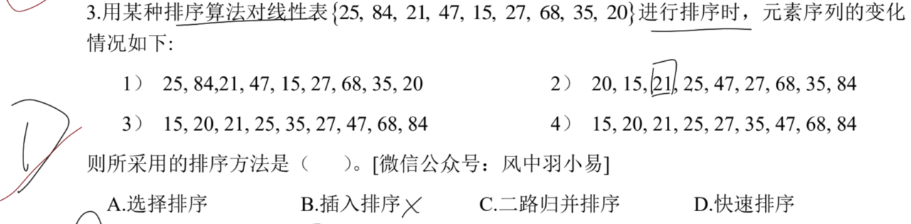
> 快速排序一般选择待排序序列中的首个元素作为枢轴，**两端放置左右指针**，**先从右指针开始查找比枢轴小的元素，找到后和左指针元素互换；下一步从左指针开始往右找比枢轴大的元素，找到后和右指针元素互换。当右指针在左指针的左侧时，结束本轮操作。**
> 此处就是选取元素 `25` 作为枢轴元素。
> 右指针扫到 20，比枢轴小，发生交换，`[20] 84 21 47 15 27 68 35 [25]`；
> 左指针扫到 84，比枢轴大，发生交换，`20 [25] 21 47 15 27 68 35 [84]`；
> 右指针扫到 15，比枢轴小，发生交换，`20 [15] 21 47 [25] 27 68 35 84`；
> 左指针扫到 47，比枢轴大，发生交换，`20 15 21 [25] [47] 27 68 35 84`；
> 最终结果为 `20 15 21 [25] 47 27 68 35 84`，满足序列 2 的情况。

> **注意点**：快排本质是基于双指针实现的，通过不断地将枢轴元素与小、大元素进行交替互换以达到目的。
> 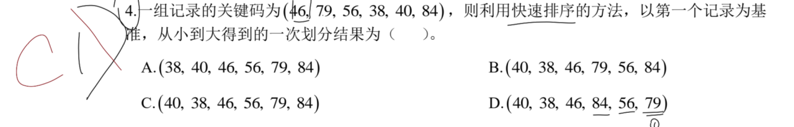
> 这里错误在于对快排的元素互换理解成插入。
> **正确做法**：
> 此处选取元素 `46` 作为枢轴元素。
> 右指针扫到 40，比枢轴小，发生交换，`[40] 79 56 38 [46] 84`；
> 左指针扫到 79，比枢轴大，发生交换，`40 [46] 56 38 [79] 84`；
> 右指针扫到 38，比枢轴小，发生交换，`40 [38] 56 [46] 79 84`；
> 左指针扫到 56，比枢轴大，发生交换，`40 38 [46] [56] 79 84`；
> 最终结果为 `40 38 [46] 56 79 84`。

> **注意点**：快排在没有严格要求具体序列的时候，可以简单描述元素的排布。
> 
> 这里可以排除掉冒泡和插排，这两个必定存在已经有序的序列，而题中并没有；还可以排除掉选排，因为两趟必须排出两个最大或者两个最小有序。
> 快排是通过枢轴，将元素分成左小右大的分布，因此首个枢轴是 4，其左侧元素均小，右侧元素均大；
> 第二趟分别在左右选出枢轴，左侧可以选择 2，右侧可以选出 20，此时满足题意。

> **注意点**：无论是双向冒泡还是普通冒泡，必定要有一次确定序列有序(*没有发生任何交换*)，因此这里是 5+1=6 趟。
> 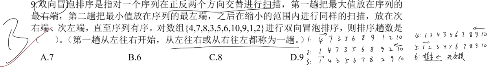

---

## 2.2. 快排专项

> **注意点**：快排本质是基于双指针实现的，通过不断地将枢轴元素与小、大元素进行交替互换以达到目的。
> 
> 这里错误在于对快排的元素互换理解成插入。
> **正确做法**：
> 此处选取元素 `46` 作为枢轴元素。
> 右指针扫到 40，比枢轴小，发生交换，`[40] 79 56 38 [46] 84`；
> 左指针扫到 79，比枢轴大，发生交换，`40 [46] 56 38 [79] 84`；
> 右指针扫到 38，比枢轴小，发生交换，`40 [38] 56 [46] 79 84`；
> 左指针扫到 56，比枢轴大，发生交换，`40 38 [46] [56] 79 84`；
> 最终结果为 `40 38 [46] 56 79 84`。

> **注意点**：快排本质是基于双指针实现的，先*右指针移动交换*再*左指针移动交换*依次交互，最后得到结果。
> 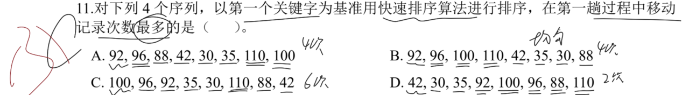
> 由于**右指针找小值，左指针找大值**，只要满足，左指针和右指针只移动一次就发生交换，那么移动次数就会最多。
> 也就是右侧元素依次都比枢轴元素小，左侧元素依次都比枢轴元素大。
> **正确分析**：
> A：枢轴为 92，右指针移动 2 次，发生交换，序列 `[35] 96 88 42 30 [92] 110 100`；左指针移动 1 次，发生交换，序列 `35 [92] 88 42 30 [96] 110 100`；右指针移动 1 次，发生交换，序列 `35 [30] 88 42 [92] 96 110 100`；左指针移动 4 次，右指针在左指针的左侧，结束操作。总移动记录 3 次。
> B：枢轴为 92，右指针移动 1 次，发生交换，序列 `[88] 96 100 110 42 35 30 [92]`；左指针移动 1 次，发生交换，序列 `88 [92] 100 110 42 35 30 [96]`；右指针移动 1 次，发生交换，序列 `88 [30] 100 110 42 35 [92] 96`；左指针移动 1 次，发生交换，序列 `88 30 [92] 110 42 35 [100] 96`；右指针移动 1 次，发生交换，序列 `88 30 [35] 110 42 [92] 100 96`；左指针移动 1 次，发生交换，序列 `88 30 35 [92] 42 [110] 100 96`；右指针移动 1 次，发生交换，序列 `88 30 35 [42] [92] 110 100 96`；左指针移动 1 次，右指针在左指针的左侧，结束操作。总移动记录 7 次。
> C：枢轴为 100，
> D：枢轴为 42，

> **注意点**：快排在没有严格要求具体序列的时候，可以简单描述元素的排布：**从小到大：在枢轴左侧小，枢轴右侧大**；**从大到小：在枢轴左侧大，枢轴右侧小**。
> 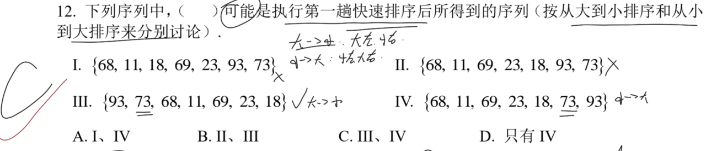
> 综上，只有Ⅲ和Ⅳ可以找到那个枢轴元素，使得排布成立。
> Ⅲ中是从大到小排序，枢轴选为 73；Ⅳ中是从小到大排序，枢轴选为 73。

> **注意点**：快排每次都需要选择一个枢轴，而其他元素都需要根据大小分布在其左右两侧。
> 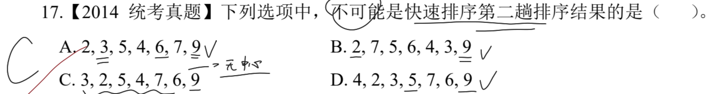
> A：第一趟选择 6，第二趟左侧选择 3，右侧选择 9；
> B：第一趟选择 2，因为只有右侧，所以第二趟选择 9；
> C：第一趟选择 9，因为只有左侧，所以第二趟在左侧中找可能的枢轴，左侧无法选出；
> D：第一趟选择 9，因为只有左侧，所以第二趟选择 5。

> **注意点**：和上一题类似，只要能确定每一趟的枢轴即可证明是该趟数的结果。
> 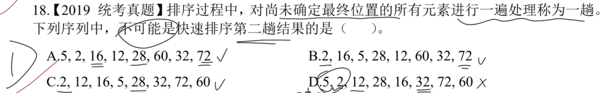
> A：第一趟选择 72，第二趟左侧选择 28；
> B：第一趟选择 2，第二趟右侧选择 72；
> C：第一趟选择 2，第二趟右侧选择 28；
> D：第一趟选择 12，第二趟右侧选择 32，左侧无法选出。

> **注意点**：和此前题目思路一致，只满足枢轴的左侧小，右侧大即可。唯一需要注意的是：**注意题目是升序还是降序。**
> 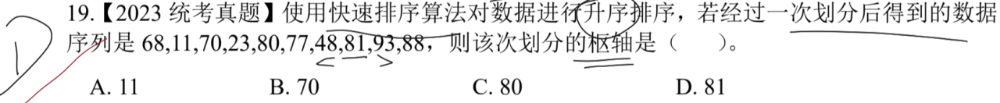

> **注意点**：快排是将整个序列通过枢轴分为左右两个部分，类似于二叉排序树的思想，枢轴就作为根结点，但这里左右子树内部不一定有序。
> 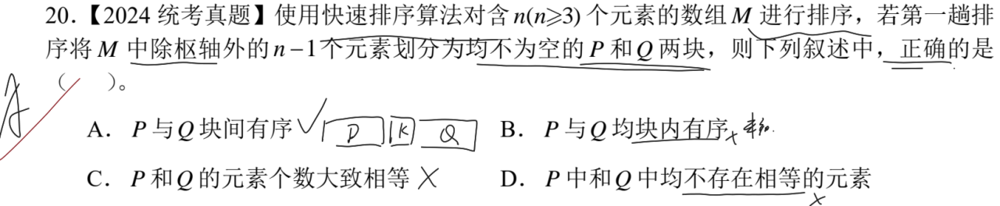
> 因此只有 A 项是正确的，如果是升序序列，必定存在 `P < k < Q`，反之亦然。如果在排序过程中出现相同的元素跳过即可，每次交换必须大于或者小于，等于时无序交换次序。
> **但快排是一个不稳定排序算法。**

---

## 三、 选择排序

选择排序分为简单选择排序和堆排序两种。主要考察的还是堆的相关内容。
**简单选择排序**：选择序列中最小的元素，放至序列首位，依次往后。
**堆**：本质是一个完全二叉树，分为大根堆和小根堆两种结构。
- 大根堆中，堆顶元素是序列最大的，从该元素到任一叶子节点均是有序的；
- 小根堆中，堆顶元素是序列最小的，从该元素到任一叶子节点均是有序的。

## 3.1. 小根堆

### 3.1.1. 小根堆基本概念与建堆

> **注意点**：堆的本质是一个完全二叉树，而小根堆中的最大关键字必定在最后一个叶子结点。
> 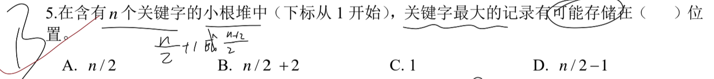
> 因此这里最大关键字可能存储在 $\frac{n}{2} + 1 \ 或者 \ \frac{n+2}{2}$。

> **注意点**：本质就是探究二叉排序树和完全二叉树的性质关系，但这里的小根堆还有一些特殊的性质需要注意。
> 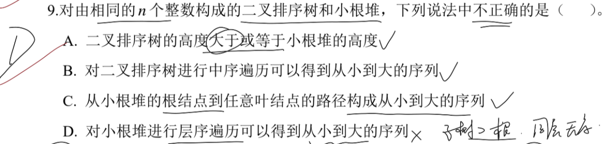
> D：小根堆只能实现每个分支结点的元素小于孩子结点，但是并不保证同层的兄弟结点的大小关系。

> **注意点**：直接构造一个小根堆即可，再按照层序遍历即可得到小根堆的序列。
> 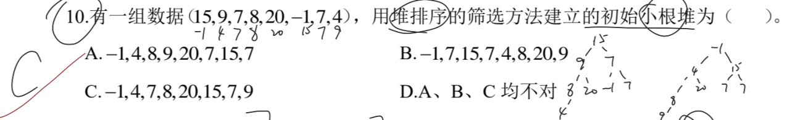

---

### 3.1.2. 小根堆的插删操作

**插入操作**：每次都插入整个堆的最后一层，作为叶子结点存在，满足完全二叉树的性质，再调整直至满足小根堆的性质；
**删除(输出)操作**：一般是删除堆顶元素，**但无论删除哪个元素，都需要和最后一个叶子结点进行交换后删除(输出)**，如果本身就是最后一个叶子结点那直接删除(输出)即可。
- 除了本身删除的是叶子结点，其余结点每次删除后都需要恢复小根堆的状态。

> **注意点**：输出两个最小关键码之前需要先构造出初始小根堆，然后再进行输出操作。
> 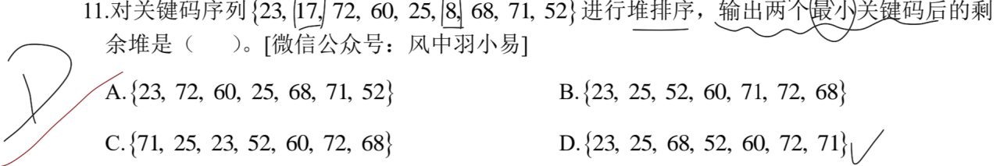
> 操作过程如下图所示：
> 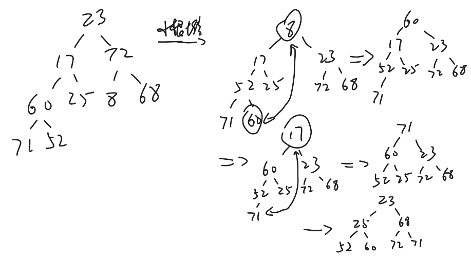
> 值得注意的是：**不可直接在原始序列中直接删除最小的元素，可能会导致完全二叉树的构造完全不同，从而导致最终的小根堆序列不同**。

> **注意点**：如果初始已经是小根堆，那么就按照完全二叉树的排布构造出树即可。
> 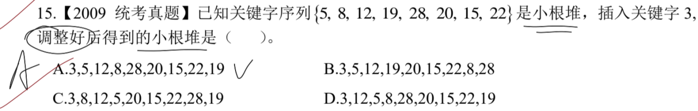
> 操作过程如下图所示：
> 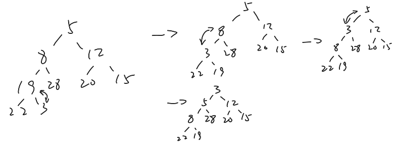
> 插入过程中需要先兄弟结点比较，小的结点再和父结点比较，如果还小那么就交换；
> 每次都从最后一个子树开始比较，然后依次往上。

> **注意点**：无论是插入还是删除，恢复堆性质的过程都是优先左右兄弟先比较出最小，再由最小和父结点比较。
> 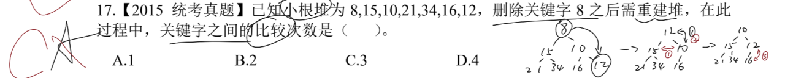
> 已经有序的部分就不需要进行多余的比较，比如上图中的左子树并没有参与到比较中，因为本身就满足小根堆的性质。

---

## 3.2. 大根堆

### 3.2.1. 大根堆基本概念与构造过程

> **注意点**：构造堆的过程中，按照完全二叉树的放置方式。最后统一调整成大根堆。
> 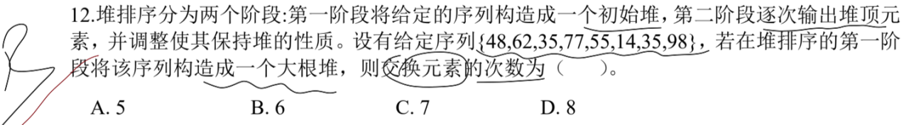
> 过程如下图所示：
> 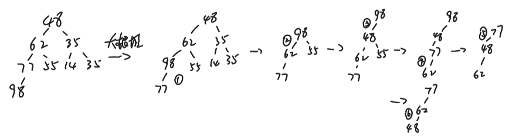
> **每次都从最后一个叶子结点开始依次往上比较**，如果父结点更大就不发生交换，反之发生交换。

> **注意点**：大根堆构造过程在树的展示上是孩子结点和父结点之间的比较和交换；但在原始序列上就是两个位置上的元素发生交换操作。
> 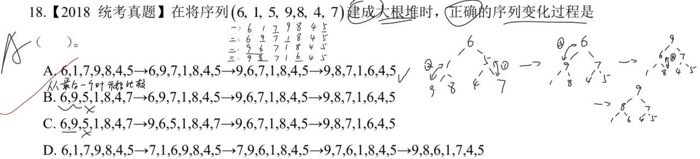
> 此题只需要按照大根堆的性质，记录每一次发生交换的两个元素，让他们在序列层面发生交换。
> 因此过程如上图所示。

> **注意点**：堆可以看作一棵完全二叉树，而完全二叉树通常使用顺序存储的方式存储数据。
> 虽然完全二叉树也能使用链式存储，但并不适用于堆这种经常发生交换的数据结构，因此使用顺序存储方式保存堆。
> 大根堆的最大值必定在根结点，次大值也必定在其下一层，若不在，某个子树就必定不满足大根堆的性质。
> **换个问法，第三大的值必定在第二层。这点是错误的，因为根的左右子树的根结点是其对应子树下的最大值，但并不意味着两个子树之间的大小关系。**
> 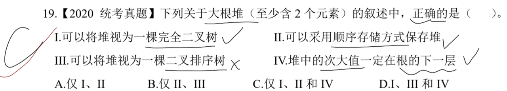

---

### 3.2.2. 大根堆的插删操作

**插入操作**：每次都插入整个堆的最后一层，作为叶子结点存在，满足完全二叉树的性质，再调整直至满足大根堆的性质；
**删除(输出)操作**：一般是删除堆顶元素，**但无论删除哪个元素，都需要和最后一个叶子结点进行交换后删除(输出)**，如果本身就是最后一个叶子结点那直接删除(输出)即可。
- 除了本身删除的是叶子结点，其余结点每次删除后都需要恢复大根堆的状态。

> **注意点**：删除操作需要先将堆顶元素与最后一个叶子结点元素进行互换，然后再删除。
> 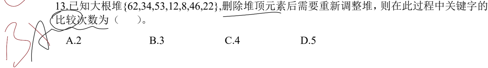
> 过程如下图所示：
> 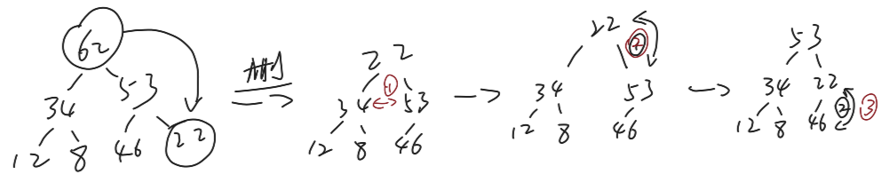
> 值得注意的是，次数需要从上层往下开始比较大小，先从孩子结点中选择出最大的元素，再将这个最大元素和父结点比较。
> 若是下移之后，需要再新的子树中进行比较，直至无需交换。

> **注意点**：每一次的插入都需要保证当前满足大根堆的性质。
> 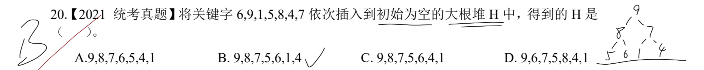

> **注意点**：每一次删除都需要保证删除后仍然是大根堆，所以需要重新调整后再继续删除元素。
> 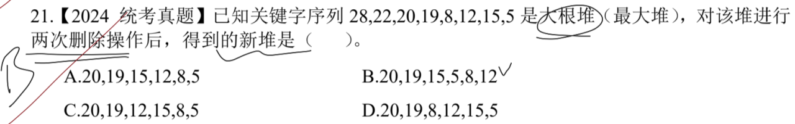
> 过程如下图所示：
> 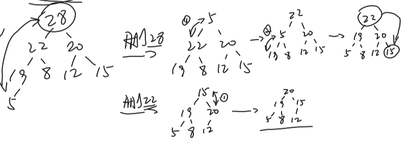
